<p align="center">
  
</p>

<h1 align="center">PortRelay</h1>

<p align="center">
  <b>Share internal services with teammates temporarily and safely: send an invite link, and access expires on its own.</b>
</p>

<p align="center">
  <a href="https://github.com/DeepFal/PortRelay/actions/workflows/ci.yml"></a>
  <a href="https://github.com/DeepFal/PortRelay/releases"></a>
  <a href="LICENSE"></a>
  
  
</p>

<p align="center">
  <a href="README.md">简体中文</a> · English
</p>

<p align="center">
  
</p>

Your machine can reach an internal network: a database, a jump host, an internal dashboard. Your teammates can't. The usual fixes are VPN accounts, firewall tickets, or opening the port to everyone and forgetting to close it again.

PortRelay turns that into three steps:

1. The **agent** exposes an internal target on a port of the **edge gateway**.
2. You send a teammate an **invite link** (or QR code).
3. They open it and enter their name. Their device can then connect for a limited time. Access ends when it expires, when the tunnel sits idle, or when you revoke it, and live connections are cut immediately.

> [!TIP]
> **No particular network setup is required.** The machine running the agent only needs to reach **both the target network and the edge gateway**. How the agent reaches the gateway is up to you: the same LAN, a corporate VPN, Tailscale, ZeroTier, WireGuard, or a gateway with a public address. The agent only dials out and opens no inbound ports.

> [!NOTE]
> The user interface (macOS app, web panel and invite pages) is currently in Simplified Chinese.

## Contents

- [Features](#features)
- [Screenshots](#screenshots)
- [How it works](#how-it-works)
- [Quick start](#quick-start)
- [Configuration](#configuration)
- [Security model](#security-model)
- [FAQ](#faq)
- [Development](#development)

## Features

**Access control**

- Three access modes: **invite-only** (the default and safest), an IP / CIDR allowlist (which can be combined with invites), and open to all.
- Each invite link has its own expiry, device limit, access duration once granted (1 h, 2 h, 8 h, until end of day, or until the tunnel closes) and an optional approval step.
- When approval is required, the app shows a system notification and you approve or deny with one click. The requester's page refreshes on its own.
- **The access clock starts at the first connection**, so a teammate can accept an invite now and use it later.
- When access expires or is revoked, **existing connections are dropped too**. Unauthorized connections are reset (TCP RST) and logged.
- **Tunnel groups** open several hosts and ports at once (for example `10.0.1.11-13` × `22, 8080`) on a contiguous block of gateway ports. A group shares one invite link and one set of grants: a teammate is authorized once for the whole group, and one revoke disconnects them everywhere.

**Tunnel lifecycle**

- **Idle auto-close.** The idle timer starts when a tunnel has no connections, no active grants, no pending requests and no invite links with uses left. By default the tunnel closes after 30 minutes of idle time.
- An optional **maximum open time** closes the tunnel at a fixed point, whether or not it is in use.
- While any address in a group is in use, the whole group counts as in use; members are switched on and off together.
- PortRelay records the first-connection time, the actual connected time and why each tunnel was closed.
- Editing a tunnel keeps existing connections. Moving a tunnel binds the new port before releasing the old one.

**Observability**

- A 10-minute traffic chart for each tunnel, plus live rates, connection counts and session/total bytes.
- Online devices are grouped by IP and can be disconnected one by one. The connection history is grouped the same way.
- Per-tunnel bandwidth limit in MB/s.

**Clients**

- A native macOS menu-bar app (SwiftUI). Closing the window leaves only the menu-bar icon; quitting from the menu also stops the background agent.
- An embedded web panel with the same features on Linux and Windows.
- Tunnel search, including pinyin initials (for example `sjk` finds “数据库”), and a status filter.

## Screenshots

<p align="center">
  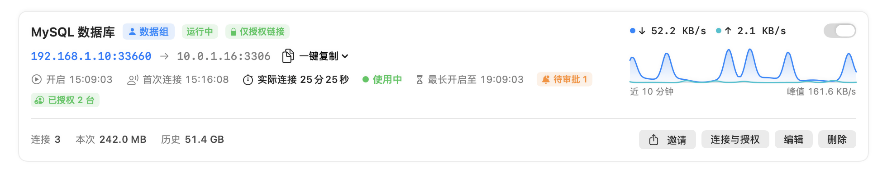
  <br><sub>A tunnel card: access address, grants, connected time and the last 10 minutes of traffic (sped up)</sub>
</p>

<picture>
  <source media="(prefers-color-scheme: dark)" srcset="docs/images/app-main-dark.png">
  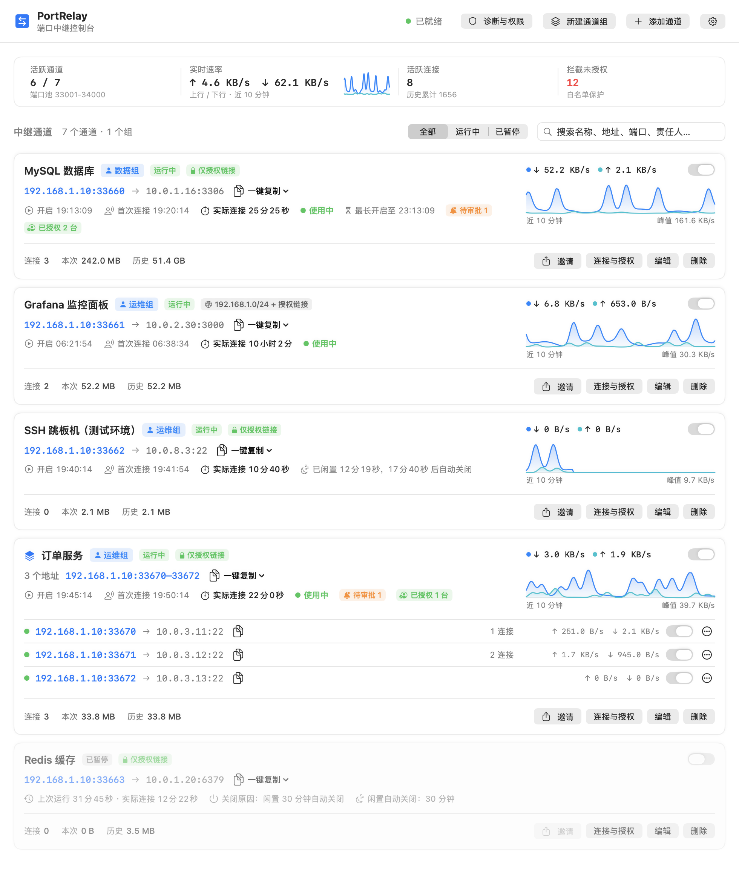
</picture>

**Invites.** Generating an invite gives you a ready-to-send message and a QR code. The teammate opens the link on a phone or laptop and enters their name. If approval is required, they wait on a status page that updates when you decide.

<p align="center">
  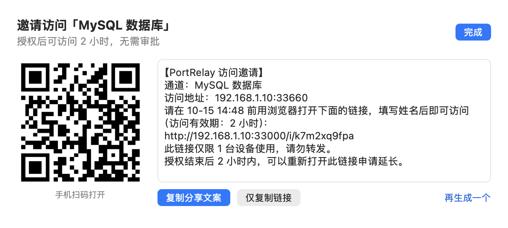
</p>

<table>
  <tr>
    <td align="center">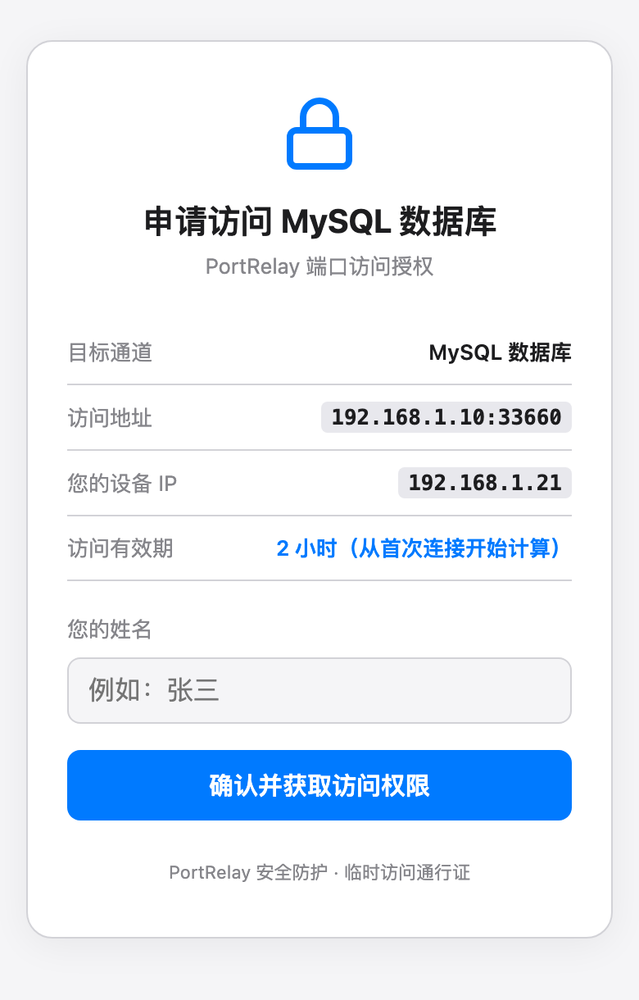<br><sub>① Open the invite link</sub></td>
    <td align="center">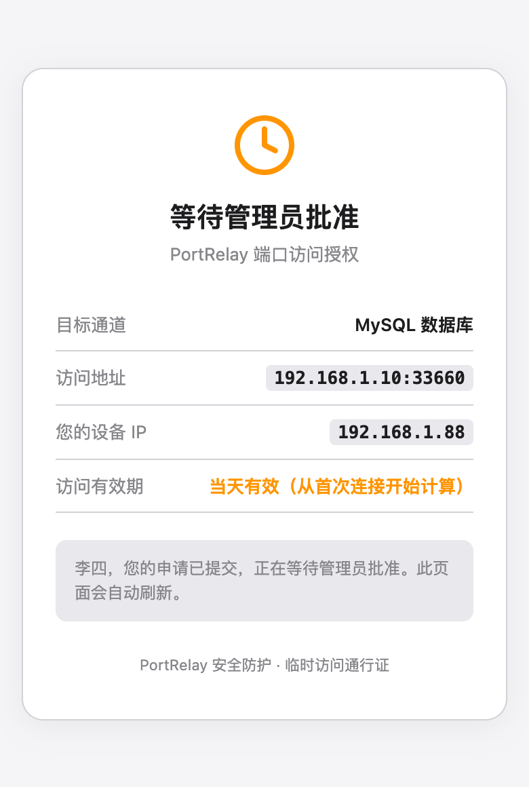<br><sub>② Wait for approval (optional)</sub></td>
    <td align="center">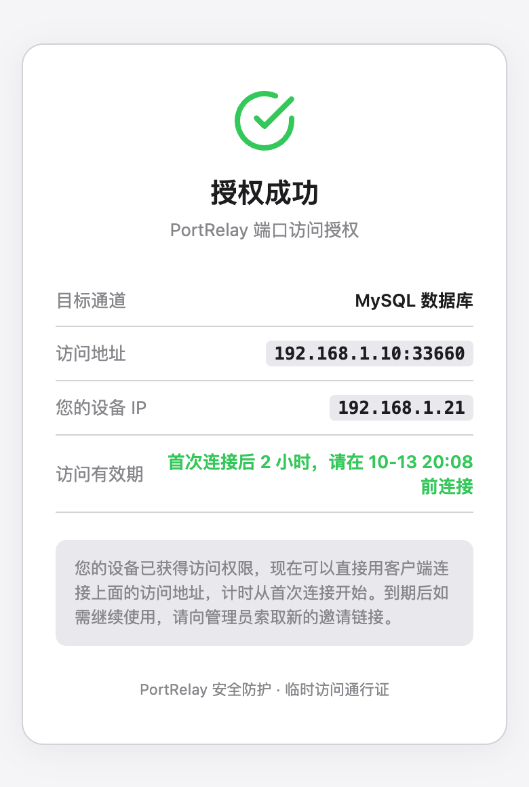<br><sub>③ Access granted</sub></td>
  </tr>
</table>

**Tunnel groups.** A group card sums up the state and traffic of the whole group and lists every access address. Each address can be switched, invited or moved out on its own.

<p align="center">
  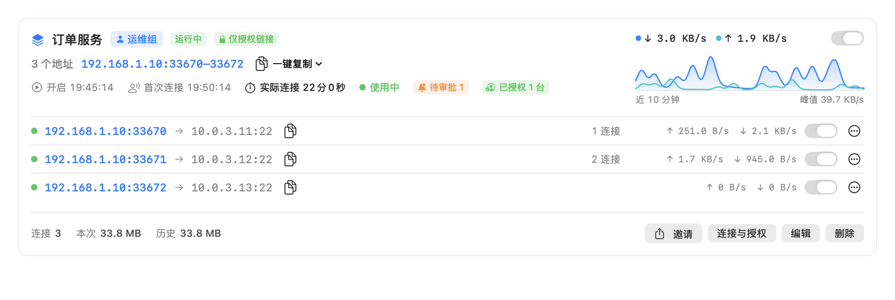
</p>

**Access management.** Pending requests, authorized devices (with online state and remaining time) and active invite links are all managed in one place.

<p align="center">
  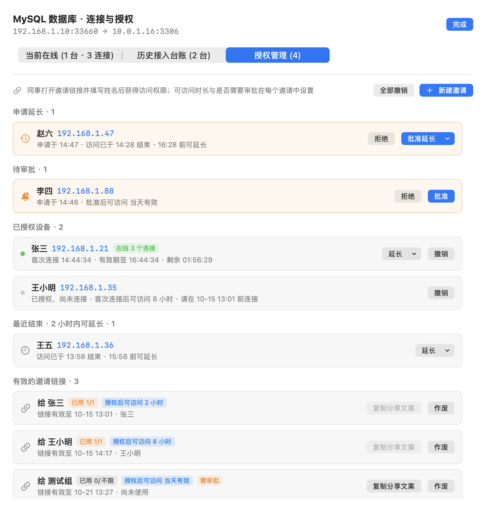
</p>

<details>
<summary><b>Web panel and more screenshots</b></summary>
<br>

Without the macOS app, the agent serves a web panel at `http://127.0.0.1:33080`:

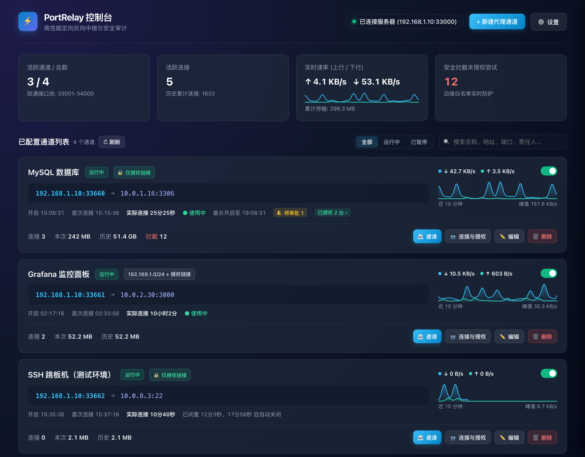

<table>
  <tr>
    <td align="center">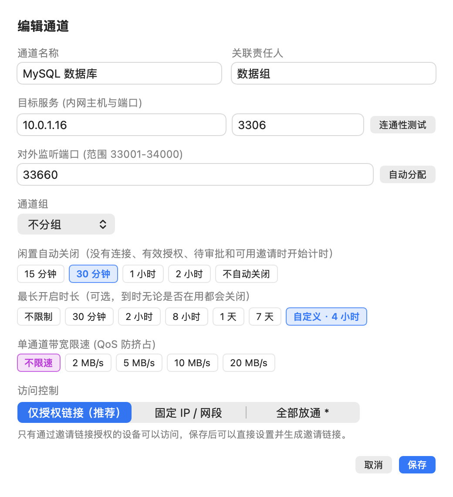<br><sub>Edit tunnel: access mode, idle close, max open time</sub></td>
    <td align="center">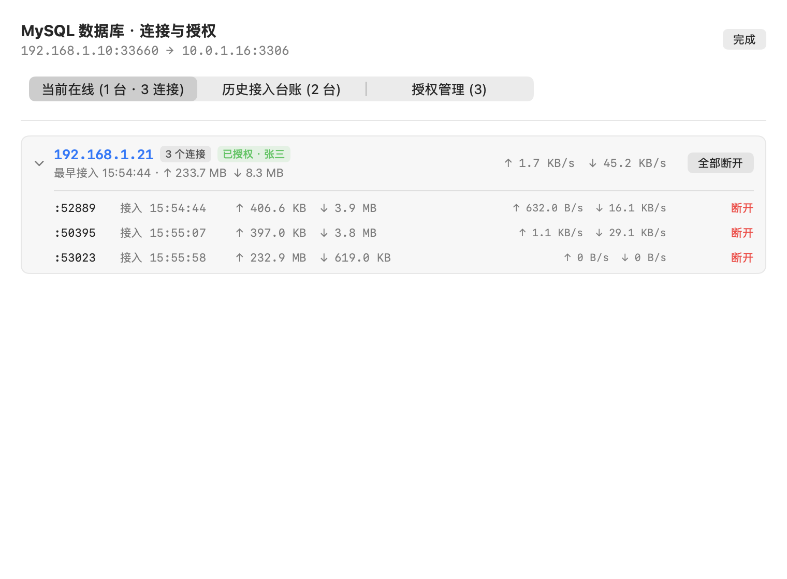<br><sub>Online devices, grouped by IP</sub></td>
  </tr>
</table>

</details>

## How it works

<p align="center">
  
</p>

- The **edge gateway** (`portrelay-server`) runs where visitors can reach it and manages a port pool (default `33000-34000`). Port `33000` is the control port. The agent tunnel and the invite web pages share it: HTTP requests go to the invite pages, and anything else is treated as an agent session.
- The **agent** (`portrelay-agent`, bundled in the macOS app) runs on a machine that can reach the target network. It dials the gateway's control port, authenticates with a token, and multiplexes all tunnels over that single TCP connection using [yamux](https://github.com/hashicorp/yamux).
- When a visitor connects to `gateway:33660`, the gateway checks the allowlist and access grants.
  - If the visitor is allowed, the gateway opens a stream through the tunnel, the agent dials `10.0.1.16:3306`, and bytes are relayed both ways.
  - Otherwise the connection is reset and logged.
- Grants, invites and approval requests live in a state file on the gateway and survive restarts. Tunnel settings, traffic history and the connection log are kept on the agent's machine.

## Quick start

### 1. Deploy the edge gateway (Linux)

The gateway must be reachable by **visitors** and by **the agent**. Open TCP `33000-34000` in your firewall.

**Option A: binary + systemd (recommended)**

```bash
VERSION=1.0.0   # see the Releases page
curl -LO https://github.com/DeepFal/PortRelay/releases/download/v$VERSION/portrelay-$VERSION-linux-amd64.tar.gz
tar xzf portrelay-$VERSION-linux-amd64.tar.gz && cd portrelay-$VERSION-linux-amd64
sudo ./deploy/install-server.sh ./portrelay-server

# The installer generates a random token; you will enter it in the agent
sudo grep PORTRELAY_TOKEN /etc/portrelay-server.env
```

The installer does four things:
- installs the binary into `/usr/local/bin`;
- writes a [systemd unit](deploy/portrelay-server.service), which runs as a dynamic system user and keeps state in `/var/lib/portrelay`;
- enables the service at boot;
- keeps your existing configuration when you re-run it to upgrade.

**Option B: Docker**

```bash
TOKEN=$(openssl rand -hex 24); echo "token: $TOKEN"
docker run -d --name portrelay --network host --restart unless-stopped \
  -e PORTRELAY_TOKEN=$TOKEN -v portrelay:/var/lib/portrelay \
  ghcr.io/deepfal/portrelay-server:latest
```

> [!IMPORTANT]
> Use `--network host`. Allowlists rely on the visitor's real source IP, and port publishing may replace it with a bridge address. See also the [docker-compose example](deploy/docker-compose.yml).

**Option C: build from source**

```bash
git clone https://github.com/DeepFal/PortRelay.git && cd PortRelay
make server        # dist/portrelay-server-linux-{amd64,arm64}
```

### 2. Run the agent

**macOS app.** Download `PortRelay-*-macos-universal.zip` from [Releases](https://github.com/DeepFal/PortRelay/releases), unzip it and move it to Applications.

> [!NOTE]
> The app is not notarized. On first launch, right-click it in Finder and choose Open, or run `xattr -dr com.apple.quarantine /Applications/PortRelay.app`. You can also build it yourself with `make app`.

Open ⚙️ Settings and fill in:

| Setting | Value |
| --- | --- |
| Server control address (服务器控制地址) | The address the **agent** uses to reach the gateway, e.g. `gw.example.com:33000`, `192.168.1.10:33000` or `100.x.y.z:33000` |
| Token (安全令牌) | `PORTRELAY_TOKEN` from the gateway |
| Public access address (对外访问地址) | The address **teammates** use to reach the gateway. Leave it empty to use the same host. |

> Example: the agent reaches the gateway over Tailscale at `100.64.0.10`, while teammates in the office use the LAN address `192.168.1.10`. Set the control address to `100.64.0.10:33000` and the public access address to `192.168.1.10`. Invite links and share messages will use the LAN address.

**Linux / Windows.** Download the archive for your platform, run the agent, and use the web panel that opens in your browser.

```bash
./portrelay-agent              # panel at http://127.0.0.1:33080
./portrelay-agent -no-browser  # don't open a browser
```

### 3. Create a tunnel and invite someone

1. Click **添加通道** (Add tunnel) and enter a name and a target such as `10.0.1.16:3306`. You can probe the target from your machine first, and a free port is suggested automatically.
2. Keep the default access mode, **仅授权链接** (invite-only). Click **邀请** (Invite), then choose how long access lasts, how many devices may use the link, and whether approval is required.
3. Send the generated message or QR code. Once the teammate has entered their name, they can connect their database client or SSH to `192.168.1.10:33660`.

To open several hosts at once (a set of servers, say), click **新建通道组** (New tunnel group), enter hosts `10.0.1.11-13` and ports `22`, check the previewed port mapping and create it, then click **邀请整组** (Invite group). Existing tunnels can be ticked to join the group as well.

## Configuration

**Gateway: `portrelay-server`**

| Flag | Default | Description |
| --- | --- | --- |
| `-token` / `PORTRELAY_TOKEN` | required | Shared secret for agent authentication; generate it with `openssl rand -hex 24` |
| `-listen` | `:33000` | Control port, shared by the agent tunnel and the invite pages |
| `-port-min` / `-port-max` | `33000` / `34000` | Tunnel port pool |
| `-state` | `/var/lib/portrelay/leases.json` | Where grants, invites and requests are persisted; leave it empty to keep them in memory only |
| `-public-host` | empty | Address shown to visitors on the invite page; defaults to the host the visitor used to open the link |
| `-trust-proxy` | `false` | Trust `X-Forwarded-For` / `X-Real-IP`. **Enable it only behind a trusted reverse proxy.** |
| `-version` | | Print the version |

**Agent: `portrelay-agent`**

| Flag | Default | Description |
| --- | --- | --- |
| `-port` | `33080` | Local panel / API port; listens on `127.0.0.1` only |
| `-no-browser` | `false` | Don't open the panel on start |
| `-version` | | Print the version |

Agent settings live in `~/.portrelay/config.json`. The file has mode 0600 and is written atomically. If it is corrupt, it is backed up and replaced with defaults.

## Security model

- **Agent authentication.** The first message on a new connection must be a token check, compared in constant time. Only authenticated sessions can register tunnels, and a new session replaces the old one.
- **Deny by default.** New tunnels admit only devices that hold a grant. A grant applies to one tunnel and one source IP, and always has an expiry.
- **Expiry is enforced live.** The gateway re-checks open connections every second and drops any whose grant has ended.
- **The local API is loopback-only.** The panel binds to `127.0.0.1` and validates `Host` and `Origin` to block DNS rebinding and cross-site requests.

> [!WARNING]
> - **The agent ↔ gateway link is not encrypted yet.** The token and all relayed data travel in plain text. Run that hop over a trusted network or an encrypted overlay (WireGuard, Tailscale, ZeroTier, an IPsec VPN, …), or wrap it in your own TLS tunnel.
> - Grants are tied to the **source IP**. Visitors behind the same NAT address share a grant.
> - Traffic between visitors and the gateway uses the target service's own protocol. Whether it is encrypted depends on that service (for example, whether MySQL has TLS enabled).

## FAQ

<details>
<summary><b>Do I need Tailscale?</b></summary>

No. PortRelay only needs the agent's machine to reach the target network and to open a TCP connection to the gateway's control port. Tailscale is just one way to provide that path; a LAN, a VPN or a public address work equally well.
</details>

<details>
<summary><b>How is this different from frp or <code>ssh -R</code>?</b></summary>

Those tools are more general port forwarders. PortRelay focuses on **temporary, per-person access**:
- deny by default;
- per-device grants through invite links, with optional approval;
- clocks that start at the first connection;
- automatic expiry and idle close;
- a GUI and a connection log.

If you only need one long-lived forward, frp or SSH is simpler.
</details>

<details>
<summary><b>Can one gateway serve several agents?</b></summary>

Not at the same time: a new authenticated session replaces the previous one. For several agents, run several gateway instances with different port pools and tokens.
</details>

<details>
<summary><b>What happens when the gateway restarts?</b></summary>

Live connections drop. Grants, invite links and approval requests are kept in the state file and stay valid. The agent reconnects and re-registers its tunnels automatically.
</details>

<details>
<summary><b>Visitors show up with the wrong IP, or the allowlist doesn't work</b></summary>

Check for NAT, port publishing or a reverse proxy in front of the gateway. With Docker, use `--network host`. Enable `-trust-proxy` only behind a trusted proxy; otherwise `X-Forwarded-For` can be spoofed.
</details>

<details>
<summary><b>macOS says the developer cannot be verified</b></summary>

Release builds are ad-hoc signed, not notarized. Right-click the app and choose Open, or run `xattr -dr com.apple.quarantine /Applications/PortRelay.app`.
</details>

## Development

Building requires Go 1.23+. The macOS app also needs the Xcode command-line tools and runs on macOS 13 or later.

```bash
make test         # gofmt check + go vet + go test -race
make agent        # build the agent for this platform into bin/
make app          # build PortRelay.app (UNIVERSAL=1 ./build-app.sh for a universal binary)
make release      # package gateway + agent for all platforms into dist/
make snapshots    # render app screens offscreen into tools/ui-snapshots/out/
```

```text
cmd/portrelay-server   gateway entry point
cmd/portrelay-agent    agent entry point (embeds the web panel in web/)
server/                gateway: agent sessions, listeners, allowlists and grants, invites and invite pages
client/                agent: config, tunnels, local API, idle close, traffic stats
core/                  protocol messages, ACL, traffic metering and rate limiting
mac-native/            SwiftUI menu-bar app
deploy/                systemd and Docker Compose examples, install script
tools/ui-snapshots/    offscreen screenshot renderer and README GIF builder (mkgif)
```

All screenshots and animations in this README come from mock data:
- `tools/ui-snapshots/render.sh readme` renders the screenshots;
- `FRAMES=40 tools/ui-snapshots/render.sh gif` renders the animation frames;
- `go run ./tools/ui-snapshots/mkgif` encodes the frames as a GIF.

Issues and pull requests are welcome. Please run `make test` before submitting.

## License

[MIT](LICENSE) © DeepFal
